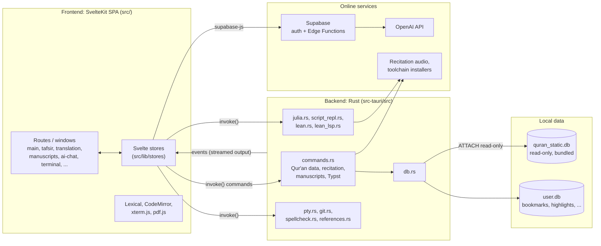

# AyahLab

A desktop workbench for studying the Qur'an. AyahLab puts the Arabic text,
word-level morphology, translations, tafsir, recitations and manuscripts next
to a writing and analysis environment, so you can read, annotate, research and
write about the Qur'an in one place.

AyahLab runs on macOS, Windows and Linux.

> [!IMPORTANT]
> **AyahLab is made purely for Qur'anic studies, and for Hadith studies, which
> are planned but not yet available.**
>
> It is not a general-purpose data-analysis tool or a general IDE. The code
> editors, notebooks, terminal and file explorer exist to serve the study of
> these texts: analysing the Qur'anic dataset, writing up research, and
> reproducing results. They are not meant to compete with VS Code, RStudio or
> Jupyter for unrelated work. Feature requests and contributions are judged by
> whether they help someone study the Qur'an (and, later, Hadith).

## Contents

- [Features](#features)
- [Tech stack](#tech-stack)
- [Architecture](#architecture)
- [Getting started](#getting-started)
- [Running in dev mode](#running-in-dev-mode)
- [Building](#building)
- [Tests and checks](#tests-and-checks)
- [Contributing and reporting issues](#contributing-and-reporting-issues)
- [Data sources and credits](#data-sources-and-credits)
- [License](#license)

## Features

**Reading the Qur'an**

- Uthmani Arabic text with surah and ayah navigation, search, bookmarks,
  highlights and last-read position.
- Word-level morphology: part of speech, root, lemma and grammatical features
  for every word, shown in a popover or a full morphology view.
- Translations in more than 30 languages, plus word-by-word translations and
  transliteration.
- Tafsir, including Ibn Kathir and al-Tabari, in its own window.
- Ayah-by-ayah recitation from several reciters, downloadable for offline use.
- Manuscript viewer for historical Qur'an manuscripts, loaded on demand from
  [Corpus Coranicum](https://corpuscoranicum.de) (see the
  [note on manuscripts](#a-note-on-the-manuscript-viewer)).
- Verse of the day, take-home messages, and verse postcards you can export as
  images.

**Writing and research**

- A rich-text study editor (`.lexical` documents) with inline Qur'an verses,
  equations (KaTeX), tables, drawings, citations and reference lists, and
  spellchecking in several languages.
- A Typst editor with live preview and PDF export, for typeset papers and
  handouts.

**Analysis**

- Julia, Python and R editors with an attached REPL and plot viewer, for
  quantitative work on the Qur'anic dataset.
- Lean 4 cells and editor with an infoview, for formal reasoning.
- An integrated terminal and a file explorer with git status, for managing a
  study project folder.

**Account features (optional)**

- Sign-in with email or Google.
- An AI assistant for questions about the text you are studying, with usage
  limits that depend on the account tier.

The interface is available in 34 languages.

## Tech stack

| Layer | Technology |
| --- | --- |
| Desktop shell | [Tauri 2](https://v2.tauri.app) (system webview + Rust backend) |
| Frontend framework | [SvelteKit 2](https://svelte.dev/docs/kit) with Svelte 5, built as a static SPA (`adapter-static`) |
| Language | TypeScript (frontend), Rust 2021 edition (backend) |
| Styling | Tailwind CSS 4 |
| Build tooling | Vite 6, pnpm |
| Rich-text editor | [Lexical](https://lexical.dev) (with Yjs bindings) |
| Code editors | CodeMirror 6 |
| Terminal | xterm.js on the frontend, `portable-pty` (Unix PTY / Windows ConPTY) on the backend |
| Typesetting | [Typst](https://typst.app) compiled in-process (`typst`, `typst-pdf`, `typst-svg`) |
| Math | KaTeX |
| PDF viewing | pdf.js |
| Local data | SQLite via `rusqlite` |
| Git integration | `git2` (vendored libgit2) |
| Spellchecking | `spellbook` (Hunspell-compatible dictionaries) |
| Accounts and AI | [Supabase](https://supabase.com) (auth, Postgres, Edge Functions); the chat Edge Function calls the OpenAI API |
| Tests | Vitest (frontend), `cargo test` (backend) |
| CI / release | GitHub Actions, `tauri-action`, AUR publishing |

## Architecture

AyahLab is a Tauri app: a SvelteKit single-page frontend runs inside the
operating system's webview, and a Rust backend handles everything that needs
the file system, a database, child processes or the network.



### Frontend (`src/`)

- **SPA, not SSR.** `svelte.config.js` uses `adapter-static` with an
  `index.html` fallback, because a Tauri app has no Node server.
- **One route per window.** `src/routes/+page.svelte` is the main window. The
  other routes (`tafsir`, `translation`, `manuscripts`, `ai-chat`, `terminal`,
  `postcard`, `drawing`, `julia-plots`) are opened as separate native windows by
  `src/lib/utils/appWindow.ts`.
- **State lives in Svelte stores** under `src/lib/stores`, one per feature
  (editor tabs, recitation, Julia REPL, auth, settings, and so on).
- **Components** are grouped by feature under `src/lib/components`: `parchment`
  (the Qur'an reader), `editor` (code and Typst editors), `lexical` (the study
  editor and its plugins), `manuscripts`, `postcard`, and `shared` (dialogs,
  file explorer, terminal, login).
- **Translations of the interface** live in `src/lib/i18n/locales`. English
  (`en.ts`) is the fallback for any missing key.

### Frontend ↔ backend

The frontend talks to Rust in two ways:

- **Commands**: `invoke("command_name", args)` calls a `#[tauri::command]`
  function. Every command is registered in `src-tauri/src/lib.rs`.
- **Events**: long-running work (terminal output, REPL output, download
  progress) streams back to the frontend as events it subscribes to with
  `listen()`.

### Backend (`src-tauri/src/`)

| Module | Responsibility |
| --- | --- |
| `lib.rs` | App setup: plugins, managed state, the macOS menu, command registration |
| `commands.rs` | Qur'an text, morphology, translations, tafsir, bookmarks, highlights, recitation downloads, manuscripts, Typst compilation |
| `db.rs` | Opens `user.db` and attaches `quran_static.db` read-only |
| `julia.rs` | Finds or installs Julia (via juliaup) and runs the Julia REPL |
| `script_lang.rs`, `script_repl.rs` | Python and R interpreters and their REPLs |
| `lean.rs`, `lean_lsp.rs` | Finds or installs Lean 4 (via elan), compiles, and talks to the Lean language server |
| `pty.rs`, `terminal.rs` | The integrated terminal |
| `git.rs` | Git status and ignored files for the file explorer |
| `spellcheck.rs` | Spellchecking and dictionary installs |
| `references.rs` | Fetching citation metadata |
| `typst_world.rs` | The in-process Typst compiler environment |
| `startup.rs` | Writes startup crashes to a log file and shows a dialog |

### Data

The Qur'anic dataset ships as a single prebuilt SQLite file,
`src-tauri/data/quran_static.db` (around 400 MB). It is **generated, not
committed**:

1. The source files are committed under `src-tauri/data/`: the Tanzil text, the
   Quranic Arabic Corpus morphology, and the translation, tafsir,
   word-by-word, transliteration and recitation-index files.
2. The `gen-db` crate (`gen-db/src/main.rs`) reads them and writes
   `quran_static.db`.
3. At runtime, `db.rs` opens a small per-user `user.db` in the app data
   directory and attaches `quran_static.db` to it read-only. User data never
   touches the bundled file, so a new app version can ship a new dataset with
   no migration.

`DB_VERSION` in `gen-db/src/main.rs` and in `src-tauri/src/db.rs` must match;
bump both whenever the dataset or its schema changes.

### Online services

Everything except sign-in and the AI assistant works offline once recitations
and toolchains are downloaded.

- **Supabase** handles accounts. Google sign-in returns to the app through the
  `ayahlab://` deep link.
- **AI chat** goes through the `chat-completion` Edge Function in
  `supabase/functions/`, which checks the user's tier and token usage before
  calling OpenAI. Database migrations for this live in `supabase/migrations/`.

### Repository layout

```text
.
├── src/                    SvelteKit frontend
│   ├── routes/             one route per window
│   └── lib/
│       ├── components/     UI, grouped by feature
│       ├── stores/         Svelte stores (app state)
│       ├── codemirror/     CodeMirror languages and extensions
│       ├── i18n/           interface translations
│       └── utils/          shared helpers
├── src-tauri/              Rust backend and Tauri config
│   ├── src/                Tauri commands and services
│   ├── data/               dataset sources (+ generated quran_static.db)
│   ├── tauri.conf.json     base config; tauri.<platform>.conf.json overrides it
│   └── capabilities/       Tauri permission sets
├── gen-db/                 builds quran_static.db from src-tauri/data
├── supabase/               Edge Functions and SQL migrations
├── scripts/                build helpers (Tauri runner, icons, MSIX)
├── tests/                  frontend unit tests
├── static/                 static frontend assets
└── .github/workflows/      release, dataset and AUR workflows
```

## Getting started

### Prerequisites

- **Node.js**, a current LTS release.
- **pnpm**. The version is pinned in `package.json` (`packageManager`), so the
  easiest way is `corepack enable`, which picks it up automatically.
- **Rust**, the latest stable toolchain, installed with [rustup](https://rustup.rs).
- **Platform dependencies for Tauri.** Follow the
  [Tauri prerequisites guide](https://v2.tauri.app/start/prerequisites/) for
  your OS:
  - **macOS**: Xcode Command Line Tools (`xcode-select --install`).
  - **Windows**: Microsoft C++ Build Tools and WebView2 (preinstalled on
    Windows 10 and 11).
  - **Linux (Debian/Ubuntu)**:

    ```sh
    sudo apt-get install -y libwebkit2gtk-4.1-dev libjavascriptcoregtk-4.1-dev \
      libsoup-3.0-dev libappindicator3-dev librsvg2-dev patchelf
    ```

Julia, Python, R and Lean are **not** needed to build AyahLab. The app finds
them on your system or offers to install Julia and Lean when you first use
them.

### Setup

1. **Clone and install dependencies.**

   ```sh
   git clone https://github.com/alstat/furqan-desk.git
   cd furqan-desk
   pnpm install
   ```

2. **Generate the Qur'an database.** The app will not start without
   `src-tauri/data/quran_static.db`.

   ```sh
   cargo run -p gen-db --release
   ```

   If you have access to the repository's releases, you can download the
   prebuilt file instead:

   ```sh
   gh release download data --pattern quran_static.db --dir src-tauri/data
   ```

3. **Configure environment variables (optional).** You can skip this step:
   the app runs without a `.env` file. It is only needed for sign-in and the
   AI features.

   ```sh
   cp .env.example .env
   ```

   | Variable | Needed for |
   | --- | --- |
   | `VITE_SUPABASE_URL`, `VITE_SUPABASE_ANON_KEY` | Sign-in and the AI features, using your own Supabase project. Without them, the rest of the app still works. |

   Never commit `.env`; it is gitignored.

## Running in dev mode

```sh
pnpm tauri:dev
```

This starts the Vite dev server on `http://127.0.0.1:1420`, compiles the Rust
backend in debug mode, and opens the app window.

- Changes to Svelte and TypeScript files reload in the window immediately.
- Changes to Rust files or Tauri config rebuild and relaunch the app.
- The first run compiles every Rust dependency and takes a while; later runs
  are incremental.

Port 1420 must be free; Vite will not fall back to another port, because Tauri
expects that exact address.

`pnpm dev` starts only the Vite server. Opening that URL in a browser is of
limited use, because most features call the Rust backend, which exists only
inside the Tauri window.

On Linux, if the app aborts at startup with
`Could not create default EGL display: EGL_BAD_PARAMETER`, run it with
`WEBKIT_DISABLE_DMABUF_RENDERER=1 pnpm tauri:dev`.

## Building

Make sure `src-tauri/data/quran_static.db` exists first (see [Setup](#setup)).
It is bundled into the app, and a build without it crashes on launch.

### For your current OS

```sh
pnpm build:desktop
```

| OS | What it builds | Output |
| --- | --- | --- |
| macOS | A universal (Apple Silicon + Intel) `.app` | `target/universal-apple-darwin/release/bundle/macos/AyahLab.app` |
| Windows | An MSIX package via `tauri-windows-bundle` | `target/` (see the command's output) |

On Linux, build the installers directly:

```sh
pnpm tauri:build --bundles appimage,deb,rpm
```

The output goes to `target/release/bundle/`. Note that build output is in the
**workspace** `target/` directory at the repository root, not in
`src-tauri/target/`, because the root `Cargo.toml` is a Cargo workspace.

`pnpm tauri:build` with no extra arguments builds the bundle types configured
in `src-tauri/tauri.conf.json` and the platform override file for your OS.

### Code signing (macOS)

Local builds don't need signing. To sign and notarize a macOS release, set
these environment variables before building; Tauri reads them during the
build:

| Variable | Value |
| --- | --- |
| `APPLE_SIGNING_IDENTITY` | Your "Developer ID Application" certificate name |
| `APPLE_API_ISSUER` | App Store Connect API issuer ID |
| `APPLE_API_KEY` | App Store Connect API key ID |
| `APPLE_API_KEY_PATH` | Path to the matching `AuthKey_<id>.p8` file |

Keep the `.p8` key outside the repository.

### Releases

- Pushing to `main` runs `.github/workflows/release.yml`, which builds the
  Linux packages and attaches them to a **draft** GitHub release.
- Windows and macOS builds are made locally with `pnpm build:desktop` and
  attached to that draft by hand.
- Publishing the release triggers `.github/workflows/aur-publish.yml`, which
  updates the `ayahlab-bin` AUR package.
- To ship a new dataset, run the **Update Data Release** workflow; it
  regenerates `quran_static.db` and uploads it to the `data` release, which
  release builds download.

The app version appears in `package.json`, `src-tauri/tauri.conf.json`
(`version` and the window `title`); keep them in sync when you bump it.

## Tests and checks

```sh
pnpm check            # Svelte and TypeScript type checking
pnpm vitest run       # frontend unit tests
cargo test -p AyahLab # backend unit tests
```

The backend won't compile without `src-tauri/data/quran_static.db`, because
Tauri checks that every bundled resource exists, so generate it first.

## Contributing and reporting issues

Bug reports, data corrections and pull requests are welcome. Please read
[CONTRIBUTING.md](CONTRIBUTING.md) first. It explains how to report a bug, what
information to include, the project's scope, and how to send a pull request.

## Data sources and credits

AyahLab builds on the work of others:

- **Qur'an text**: [Tanzil Project](https://tanzil.net), Uthmani text version
  1.1, used under the Creative Commons Attribution 3.0 license. The text is
  included verbatim and must not be changed.
- **Morphology**: [Quranic Arabic Corpus](https://corpus.quran.com) version 0.4
  by Kais Dukes, used under the GNU General Public License. The annotation is
  included verbatim.
- **Translations, tafsir, word-by-word translations, transliteration and
  recitations** belong to their respective translators, authors, publishers
  and reciters, and remain under their own terms.
- **Manuscripts**: images and metadata come from
  [Corpus Coranicum](https://corpuscoranicum.de) (Berlin-Brandenburg Academy of
  Sciences and Humanities). They are not bundled with the app and remain under
  Corpus Coranicum's own terms.

### A note on the manuscript viewer

> [!WARNING]
> AyahLab has no agreement with Corpus Coranicum. The author asked Corpus
> Coranicum for API access for viewing their manuscripts but has not received
> a reply.

Until that changes, the manuscript viewer is built to behave like a web browser
visiting corpuscoranicum.de, and nothing more:

- It only fetches the manuscripts for the verse you open, when you open it.
- It does not offer bulk downloads, and it does not prefetch or mirror
  manuscripts in the background. You can save a single folio you are looking
  at, one at a time.
- It limits how many requests it sends at once, and keeps what it has already
  fetched (folio images on disk, verse lists and metadata in memory) so that
  reopening a verse does not ask the server again.

This is to respect Corpus Coranicum's website and to avoid putting extra load
on their servers. Please don't change the app to download manuscripts in bulk.
If Corpus Coranicum replies or publishes terms for this kind of use, the
viewer will be updated to follow them.

## License

AyahLab's source code is released under the [MIT License](LICENSE).

The MIT License does not cover the third-party data listed above, which is
bundled with the app and stays under its own license and terms of use.
